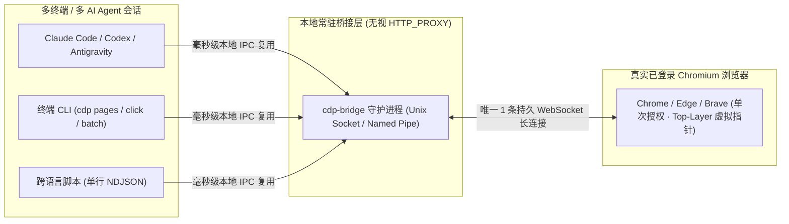

# cdp-bridge

[](./LICENSE)
[](https://nodejs.org/)
[](./package.json)
[](#快速开始)

基于 Chrome DevTools Protocol (CDP) 的**本地常驻桥接守护进程 (`cdp-bridge`)**、**命令行客户端 (`cdp`)** 与**人机协同虚拟指针（Ghost Cursor）工具包**。

专为多终端、多 **AI Coding Agent** 协同控制与验收真实已登录浏览器而设计，纯 Node.js 内置模块实现（零第三方依赖），原生支持 **Linux、WSL2 与 Windows (`win32`)**。通过后台守护进程维持与浏览器的**唯一一条持久 WebSocket 长连接**，仅需在首次连接时点击一次浏览器的“允许远程调试”授权框，后续所有 CLI 调用或脚本均通过本地 Unix Socket（`0600` 权限）或 Windows 命名管道（Named Pipe）毫秒级多路复用——**彻底告别重复授权弹窗、连接竞争与本机 `HTTP_PROXY` 代理干扰**。

---

## 工作原理与架构



| 痛点场景 | 传统直连 CDP / 每次拉起无头浏览器 | `cdp-bridge` 方案 |
| :--- | :--- | :--- |
| **浏览器登录态与风控** | 独立空白 Profile 需反复扫码登录 | 直接复用日常已登录浏览器会话与 Cookie |
| **`chrome://inspect` 授权弹窗** | 每次新建脚本连接都会重新触发浏览器弹窗 | 守护进程维持单条长连接，**仅首次点 1 次 Allow** |
| **本机代理环境干扰** | `HTTP_PROXY` 常劫持 `127.0.0.1:9222` 报 `502` | 本地 Unix Socket / Named Pipe 通信 + 直连绕过代理 |
| **AI Agent 上下文消耗** | 频繁手写冗长 `Runtime.evaluate` DOM 脚本 | 内置 `elements` 快照、`click` / `fill` / `batch` 高层原语 |
| **人机协同可见性** | 后台静默点按，用户看不清操作位置且易抢鼠标 | Top-Layer 虚拟指针实时指示，**用户点击鼠标即平滑淡出让权** |

---

## 核心特性

1. **单次握手、按需无感自启动与多路复用**
   - `cdp-bridge` 内置 30 秒心跳保活（`Browser.getVersion`）与 `DevToolsActivePort` 候选端口 **TCP 存活预检**，自动跳过已关闭浏览器的残留端口文件。
   - `start` / `connect` / `restart` 默认等待 WebSocket 真正进入 `ready` 后才返回，确保 `cdp connect 127.0.0.1:9222 && cdp pages` 原子成功无竞态。
   - **客户端按需自启动**：执行任意页面操作命令（如 `cdp pages`、`cdp elements`、`cdp click`）时，若检测到守护进程未运行或残留失效 Socket，客户端会在后台静默拉起 `cdp-bridge` 并自动重试，不污染 `--raw` 或 JSON 标准输出。
2. **Top-Layer 虚拟指针（Ghost Cursor）与点击接管**
   - 基于 Chromium 原生 `<div popover="manual">` Top Layer + 封闭 Shadow DOM（挂载于 `document.documentElement`、`<body>` 之外），不被原生 `<dialog>` 模态框遮挡、不污染 `document.body.innerText` 与元素快照、兼容严格 CSP 站点。
   - 默认开启 `fast` **极速非阻塞模式**（`0ms` 延迟播放指针飞入、点击扩散水波纹与输入焦点框，空闲 `2.6s` 自动淡出）；截图时默认自动隐藏指针保持画面纯净，加 `--with-cursor` 可随时还原最近一次指针位置与高亮框入镜。
   - **防误触人机接管**：鼠标仅从页面滑过不会中断模拟指针；一旦用户在页面内**真实点击鼠标**（`pointerdown` / `mousedown`），虚拟指针立即在 `220ms` 内平滑淡出并退出顶层渲染。
3. **现代前端组件库开箱兼容**
   - **`elements` 快照**：一键提取可见按钮、菜单项、输入框及唯一推荐选择器，免手写 DOM 探路脚本。
   - **`click`**：派发完整 `PointerEvent` + `MouseEvent` 序列，原生兼容 Radix UI / Shadcn `DropdownMenuTrigger`、Ant Design、Headless UI，支持可见元素优先、精确文本优先匹配及 `--native` 真实坐标点击。
   - **`fill`**：对 `<input>` / `<textarea>` 调用原型链原生 `value` setter 触发 React/Vue 受控状态同步；对 `.ProseMirror` / TipTap / Lexical 等 `contenteditable` 富文本编辑器自动通过 `Input.insertText` 写入并完整保留多行段落。
4. **防后台冻结与全量会话监控收口**
   - 守护进程统一托管页面 Session 附着，自动开启 `Runtime` / `Log` / `Network` 环形缓冲（含失败请求响应体前 1000 字符摘要），自动调用 `Page.setWebLifecycleState({ state: "active" })` 解除后台标签页节流冻结，并在后台标签页截图前自动唤醒防止卡死。
5. **批量流水线 (`batch`) 与工具自诊断遥测 (`diag`)**
   - 支持单次进程内顺序执行多步交互；内置 `logs/diag.jsonl` 调用遥测（单条摘要控制在 100 字以内、自动脱敏 JWT/Token/Cookie、单文件满 10MB 自动滚动保留 3 份归档）与 `cdp diag` 自分析看板。

---

## 快速开始

### 1. 前置条件：开启浏览器 CDP 远程调试

确保已安装 **Node.js >= 22**，并在 Chromium 内核浏览器（Chrome、Edge、Brave、Chromium；不支持已移除 CDP 协议的现代 Firefox）中任选一种方式开启远程调试：

- **方式一：通过浏览器内置 Inspect 页面开启（推荐，直接复用日常登录态且无需重启）**
  - **Microsoft Edge**：地址栏打开 `edge://inspect/#remote-debugging`，勾选开启远程调试（Allow remote debugging）。
  - **Google Chrome**：地址栏打开 `chrome://inspect/#remote-debugging`，勾选开启远程调试。
  - *提示：首次运行 `cdp start` 或 `cdp pages` 连接时，浏览器会弹出一次安全确认框，点击 **允许（Allow）** 即可建立持久长连接。*
- **方式二：通过命令行启动参数开启**
  - 启动浏览器时附带 `--remote-debugging-port=9222`。
  - *注意：Chrome / Edge 136+ 出于安全策略限制，对默认个人数据目录直接指定 `--remote-debugging-port` 会被忽略；使用命令行方式时需同时指定独立的 `--user-data-dir=<dir>`。若需操作主账号已登录页面，请优先使用方式一。*

### 2. 安装全局命令

```bash
git clone https://github.com/zhouzengming/cdp-bridge.git
cd cdp-bridge

# 方式 A：通过 npm link 注册全局命令（Linux / WSL2 / Windows 通用）
npm link

# 方式 B：Linux / WSL2 下也可直接软链至 ~/.local/bin（请确保 ~/.local/bin 已加入 PATH）
mkdir -p ~/.local/bin
ln -sfn "$(pwd)/src/cdp.mjs" ~/.local/bin/cdp
ln -sfn "$(pwd)/src/cdp-bridge.mjs" ~/.local/bin/cdp-bridge
ln -sfn "$(pwd)/mcp/server.mjs" ~/.local/bin/cdp-mcp
```

### 3. 启动与验证

```bash
cdp start       # 启动后台桥接守护进程并等待浏览器 WebSocket ready
cdp pages       # 列出当前打开的所有页面标签（守护进程未运行时也会自动按需拉起）
cdp status      # 只读查看连接状态、PID、转发计数与活跃会话（不触发自启动；加 --ensure 可按需拉起）
```

### 4. 接入 AI Coding Agent 插件、Skill 与可选 MCP（推荐）

- **Google Antigravity 一键安装原生插件**（内置 [`skills/cdp-bridge`](./skills/cdp-bridge/SKILL.md) 技能、精简规则与防绕过直连 `9222` 端口的 `PreToolUse` 守护 Hook）：
  ```bash
  # Linux / WSL2 推荐：轻量 CLI 版（零常驻 MCP 子进程，详见 plugins/antigravity/README.md）
  agy plugin install https://github.com/zhouzengming/cdp-bridge/tree/main/plugins/antigravity

  # 原生 Windows / 无 Shell 沙箱推荐：MCP + CLI 版（复用共享 Named Pipe，免 PowerShell 转义与乱码，详见 plugins/antigravity-mcp/README.md）
  agy plugin install https://github.com/zhouzengming/cdp-bridge/tree/main/plugins/antigravity-mcp
  ```

- **OpenAI Codex 一键安装原生插件**（通过仓库内置市场索引 [`.agents/plugins/marketplace.json`](./.agents/plugins/marketplace.json)，内置技能、`PreToolUse` 守护 Hook 与可选 MCP）：
  ```bash
  # 1) 注册市场（GitHub 远端或本地仓库路径）
  codex plugin marketplace add zhouzengming/cdp-bridge

  # 2) 按平台二选一安装：
  codex plugin add cdp-bridge@cdp-bridge        # Linux / WSL2 推荐（轻量 CLI 版，详见 plugins/codex/README.md）
  codex plugin add cdp-bridge-mcp@cdp-bridge    # 原生 Windows 推荐（MCP + CLI 版，详见 plugins/codex-mcp/README.md）
  ```

- **Anthropic Claude Code 一键安装原生插件**（通过仓库内置市场清单 [`.claude-plugin/marketplace.json`](./.claude-plugin/marketplace.json)，内置技能、`PreToolUse` 守护 Hook 与可选 MCP）：
  ```bash
  # 1) 注册市场（GitHub 远端或本地仓库路径）
  claude plugin marketplace add zhouzengming/cdp-bridge

  # 2) 按平台二选一安装：
  claude plugin install cdp-bridge@cdp-bridge        # Linux / WSL2 推荐（轻量 CLI 版，详见 plugins/claude-code/README.md）
  claude plugin install cdp-bridge-mcp@cdp-bridge    # 原生 Windows 推荐（MCP + CLI 版，详见 plugins/claude-code-mcp/README.md）
  ```

- **可选 Stdio MCP Server (`cdp-mcp`)**（适用于原生 Windows、Claude Desktop、Cursor、Codex 等，底层仍连接 `cdp-bridge` 共享 Named Pipe / Unix Socket，详见 [`mcp/README.md`](./mcp/README.md)）：
  ```json
  {
    "mcpServers": {
      "cdp-bridge": {
        "command": "cdp-mcp"
      }
    }
  }
  ```

- **通用 Agent Skill 软链挂载**（适用于 Claude Code / Codex / Antigravity 等标准技能目录）：
  ```bash
  # 工作区或全局 .agents 技能目录（Antigravity / Codex 等通用）
  mkdir -p /path/to/your-workspace/.agents/skills
  ln -sfn "$(pwd)/skills/cdp-bridge" /path/to/your-workspace/.agents/skills/cdp-bridge

  # Claude Code 全局个人技能目录
  mkdir -p ~/.claude/skills
  ln -sfn "$(pwd)/skills/cdp-bridge" ~/.claude/skills/cdp-bridge

  # Codex 全局个人技能目录
  mkdir -p ~/.codex/skills
  ln -sfn "$(pwd)/skills/cdp-bridge" ~/.codex/skills/cdp-bridge
  ```

---

## 命令详解与工作流示例

> **全局选项**（可放在子命令前或后）：
> - `-t, --target <target>`：指定目标页面（同位置参数 `<target>`，支持 Target ID/前缀、URL 子串/正则或标题匹配）
> - `--socket <path>`：覆盖控制 Socket / Named Pipe 路径
> - `--timeout <ms>`：覆盖当前命令超时时间（毫秒）
> - `--no-auto-start`：桥接守护进程未运行时直接报错退出，禁用按需自动拉起
> - `--no-diag` / `--diag-log <path>`：跳过本次遥测写入，或指定诊断日志输出路径
> - `--cursor <fast|demo|persist|off>` / `--no-cursor`：切换或关闭虚拟鼠标指针叠加模式
> - `--with-cursor` / `--keep-cursor`：截图时保留并还原虚拟鼠标指针、角标与焦点高亮框
> - `--raw`：对 `eval` / `text` 直接输出纯值或纯文本，省去外层 JSON 包装
> - `-c, --compact`：输出单行紧凑 JSON

### 1. 桥接管理与标签页生命周期（`connect` / `pages` / `open` / `close` / `focus`）

```bash
# 启动 / 重启 / 停止 / 查看状态
cdp start
cdp restart
cdp stop
cdp status --ensure

# 指定 IP:端口、DevToolsActivePort 文件或完整 WebSocket URL 切换连接
cdp connect 127.0.0.1:9222
cdp connect --port-file "/mnt/c/Users/<username>/AppData/Local/Microsoft/Edge/User Data/DevToolsActivePort"
cdp connect ws://192.0.2.10:9222/devtools/browser/3b8f...

# 列出页面标签（别名：list / tabs / list-pages；加 --all 包含 worker / iframe 等）
cdp pages
cdp pages --all
cdp targets                          # 别名：list-targets，输出原始 Target.getTargets

# 新建（支持 --background 后台静默打开不抢焦点）、置顶唤醒与关闭标签页
cdp open "http://127.0.0.1:3000/dashboard"
cdp open "http://127.0.0.1:3000/sandbox" --background
cdp focus 426B5451                   # 别名：activate，激活置顶并解除后台节流
cdp close AEB5E87A                   # 别名：page-close，关闭标签页并自动清理会话缓存
```

### 2. 页面元素快照、文本读取与 JS 执行（`elements` / `text` / `eval`）

```bash
# 快照整页或指定容器内的可见可交互元素及唯一推荐选择器（别名：page-elements / snapshot / snap）
cdp elements 426B5451
cdp elements 426B5451 "[role='dialog']" --limit 40

# 读取页面或指定容器可见文本（默认上限 50000 字符）
cdp text 426B5451 "main" --max-length 3000 --raw

# 执行任意 JS 表达式（默认 awaitPromise: true，自动处理 DOM 节点与循环引用降级序列化）
cdp eval 426B5451 "location.href" --raw
cdp eval 426B5451 --file ./inspect.js --timeout 30000
cat ./inspect.js | cdp eval 426B5451 --stdin
```

### 3. 页面导航、刷新、条件等待与截图（`navigate` / `reload` / `wait` / `screenshot`）

```bash
# 页面导航（别名：navigate / goto / nav / page-goto）
cdp goto 426B5451 "http://127.0.0.1:3000/settings"
cdp navigate --new "http://localhost:5173"

# 刷新并等待 readyState === "complete"（--ignore-cache 或 --hard 强制忽略缓存）
cdp reload 426B5451 --ignore-cache --wait-ms 800

# 轮询等待选择器、可见文本子串或真值 JS 表达式
cdp wait 426B5451 ".status-badge" --text "已完成" --timeout 15000
cdp wait 426B5451 --text "加载成功"

# 视口 / 元素裁剪 / 整页长截图（别名：screenshot / shot；默认隐藏虚拟指针，加 --with-cursor 可还原指针入镜）
cdp screenshot 426B5451 ./viewport.png
cdp screenshot 426B5451 ./pointer-state.png --with-cursor
cdp shot 426B5451 ./dialog.png --selector "[role='dialog']" --keep-cursor
cdp screenshot 426B5451 ./full.webp --full-page --format webp --quality 85
```

### 4. 表单/富文本输入、点击、悬停、滚轮滚动与批量流水线（`fill` / `click` / `hover` / `scroll` / `batch`）

```bash
# 填写受控输入框、<select> 或 TipTap/ProseMirror 富文本编辑器（别名：fill / type / page-type）
cdp fill 426B5451 ".ProseMirror" "帮我生成一份摘要" --submit --submit-selector "button[aria-label='发送']"
cdp fill 426B5451 "input[name='keyword']" --clear
cdp fill 426B5451 ".ProseMirror" --file ./prompt.txt

# 点击元素（支持 CSS 选择器或可见文本，支持点击后直接等待新元素渲染）
cdp click 426B5451 'button[aria-label="更多操作"]' --wait-for "[role='menuitem']"
cdp click 426B5451 "text=新建任务" --exact
cdp click 426B5451 ".tabs-tab" --index 1 --wait 500

# 移动并悬停虚拟指针至元素或视口坐标（默认持续显示，仅当用户鼠标点击页面接管时平滑淡出）
cdp hover 426B5451 'button[aria-label="提交"]'
cdp hover 426B5451 320,180

# 模拟真实鼠标滚轮滚动并在指针右下角标注滚动方向与像素距离（别名：scroll / wheel / page-scroll）
cdp scroll 426B5451 down 480
cdp scroll 426B5451 up 360 --cursor demo
cdp scroll 426B5451 "[role='dialog']" down 500
cdp scroll 426B5451 ".footer-cta" into-view
cdp scroll 426B5451 top

# 在单次进程与单条连接内按序执行多步操作（支持 JSON 数组或 NDJSON）
cdp batch 426B5451 --stdin <<'EOF'
[
  { "cmd": "fill", "selector": ".ProseMirror", "text": "测试批量交互" },
  { "cmd": "click", "selector": "button[aria-label='发送']" },
  { "cmd": "scroll", "direction": "down", "amount": 480 },
  { "cmd": "wait", "text": "已完成", "timeout": 20000 },
  { "cmd": "text", "selector": "main", "maxLength": 2000 }
]
EOF
```

### 5. 控制台日志、网络请求诊断与调用遥测（`logs` / `network` / `diag`）

```bash
# 查看页面近期错误/警告与未捕获异常（加 --all 包含 console.log/info）
cdp logs 426B5451
cdp logs 426B5451 --all --level error,warn,log --grep "auth|session" --limit 30 --clear

# 默认仅查看异常/失败请求（>=400 或断网错误）；支持按类型、URL 正则、HTTP 方法与状态码精准筛选
cdp network 426B5451
cdp network 426B5451 --all --type fetch,xhr --url "/api/v1/" --method POST --status 2xx,4xx,5xx

# 查看工具调用统计看板（成功率、eval 占比、子命令分布、P50/P95 延迟与 Top 报错）
cdp diag                             # 默认等价于 cdp diag summary
cdp diag summary --days 7 --agent claude-code
cdp diag errors --limit 20
cdp diag tail --limit 20 --cmd page-click
cdp diag path                        # 查看当前诊断日志文件路径与归档大小
cdp diag clear                       # 清空本地诊断日志
```

### 6. 底层原始 CDP 调用与跨语言 NDJSON 协议（`call` / `send` / `raw`）

```bash
cdp call Browser.getVersion
cdp call DOM.getDocument '{"depth": 2}' --target 426B5451
cdp raw Target.activateTarget --params '{"targetId":"426B5451000000000000000000000000"}'
```

其他语言（Python / Go / Rust 等）可直接连接本地 Unix Socket 或 Windows Named Pipe 发送单行 NDJSON 请求：
- `{"id": 1, "method": "bridge.status"}`
- `{"id": 1, "method": "bridge.attach", "params": {"targetId": "<tid>"}}`
- `{"id": 1, "method": "bridge.logs", "params": {"sessionId": "<sid>", "includeAll": false, "clear": false}}`
- `{"id": 1, "method": "bridge.network", "params": {"sessionId": "<sid>", "includeAll": false, "clear": false}}`
- `{"id": 1, "method": "bridge.shutdown"}`
- `{"id": 2, "method": "Runtime.evaluate", "params": {"expression": "document.title", "returnByValue": true}, "sessionId": "<sid>"}`

---

## 配置与运行参考

### 1. 环境变量速查表

| 环境变量 | 默认值 | 说明 |
| :--- | :--- | :--- |
| `CDP_HOST` | `127.0.0.1` | 浏览器远程调试主机 IP |
| `CDP_PORT` | 自动探测 | 浏览器远程调试端口（如 `9222`）；优先请求 `/json/version`，不可用时回退结合 `DevToolsActivePort` 路径 |
| `CDP_WS_URL` | 自动扫描 + TCP 预检 | 手动指定完整浏览器 WebSocket 地址（`ws://...`） |
| `CDP_PORT_FILE` | 自动扫描主流浏览器 | 手动指定自定义浏览器 Profile 下的 `DevToolsActivePort` 文件路径 |
| `CDP_BRIDGE_SOCKET` | 见下方运行时文件 | 自定义本地控制 Unix Socket 路径或 Windows Named Pipe 名称 |
| `CDP_CONNECT_TIMEOUT` | `15000` | 启动/重连桥接时等待浏览器 WebSocket 进入 `ready` 的最大毫秒数 |
| `CDP_NO_AUTO_START` | 未启用 (`0`) | 设为 `1` 时禁用客户端按需自动拉起守护进程 |
| `CDP_NO_WMI_BREAKAWAY` | 未启用 (`0`) | 原生 Windows 下设为 `1` 时禁用 WMI 脱离 Job Object 拉起，回退普通 `detached` 启动 |
| `CDP_CURSOR` | `fast` | 虚拟指针模式：`fast`（0 延迟，空闲 2.6s 淡出）、`persist`（常驻悬停）、`demo`（180ms 慢动作）、`off` / `0`（关闭） |
| `CDP_SCREENSHOT_CURSOR` | 未启用 (`0`) | 设为 `1` 时截图默认保留并还原模拟指针、角标与焦点高亮框 |
| `CDP_DIAG` | 启用 (`1`) | 设为 `0` / `off` 时全局关闭 `logs/diag.jsonl` 调用遥测记录 |
| `CDP_DIAG_LOG` | `<repo>/logs/diag.jsonl` | 自定义工具调用诊断日志文件路径 |

### 2. 仓库目录与运行时文件

- **仓库文件结构**：
  | 文件 / 目录 | 说明 |
  | :--- | :--- |
  | `src/cdp-bridge.mjs` | 常驻桥接守护进程（WebSocket 保活、端口发现、Session 与事件环形缓冲） |
  | `src/cdp.mjs` | CLI 客户端（页面快照、高层交互与滚轮原语、`batch` 流水线与按需自启动） |
  | `src/win-spawn.mjs` | 原生 Windows WMI (`Win32_Process.Create`) 脱离 Job Object 无黑框后台启动模块 |
  | `src/cursor.mjs` | Top-Layer (`popover="manual"`) + 封闭 Shadow DOM 虚拟指针与点击接管模块 |
  | `src/diag.mjs` | 工具调用遥测采集、敏感凭据脱敏轮转与 `cdp diag` 自分析模块 |
  | `mcp/server.mjs` + `mcp/tools.mjs` | 零依赖 Stdio MCP Server（`cdp-mcp`，共享底层 Named Pipe/Socket，免除 Windows 转义与乱码） |
  | `skills/cdp-bridge/` | 面向 AI Coding Agent 的标准技能包（含 `SKILL.md`） |
  | `plugins/` | 面向主流 Agent App 的插件适配目录（已内置 `antigravity*`、`codex*`、`claude-code*` 双版本插件） |
  | `.agents/plugins/marketplace.json` | 仓库根 Codex 插件市场目录索引（支持 `codex plugin marketplace add`） |
  | `.claude-plugin/marketplace.json` | 仓库根 Claude Code 插件市场清单（支持 `claude plugin marketplace add`） |
  | `package.json` | Node ESM 包定义与 `cdp` / `cdp-bridge` / `cdp-mcp` 全局命令入口 |

- **本地运行时文件**（自动生成，已与代码仓库隔离）：
  - **Linux / WSL2**：默认位于 `/run/user/<uid>/cdp-bridge-<uid>/`（无 `XDG_RUNTIME_DIR` 时回退至 `$TMPDIR/cdp-bridge-<uid>/`），包含 `bridge.sock`（权限 `0600`）、`bridge.sock.pid`、`bridge.sock.log` 与 `client-sessions.json`。
  - **原生 Windows (`win32`)**：控制管道位于 `\\.\pipe\cdp-bridge-<username>`，状态文件位于 `%TEMP%\cdp-bridge-<username>\`（含 `bridge.pid`、`bridge.log` 与 `client-sessions.json`）。

---

## 常见问题与排障 (FAQ)

- **首次执行命令提示等待浏览器授权（退出码 `2`）怎么办？**
  使用 `chrome://inspect` 或 `edge://inspect` 模式时，若浏览器弹出“允许远程调试”后超过 15 秒未点击，CLI 会返回退出码 `2` 并提示等待授权。此时后台守护进程仍在等待握手，只需在浏览器点击 **允许（Allow）**，再重新运行 `cdp pages` 即可联通（也可传 `--timeout 60000` 放宽等待时间）。
- **WSL2 下连不上 Windows 宿主机打开的 Chrome / Edge？**
  `cdp-bridge` 会自动扫描 `/mnt/c/Users/*/AppData/Local/.../DevToolsActivePort` 并校验端口存活。若默认 `127.0.0.1` 无法直通宿主机端口，建议在 Windows `%USERPROFILE%\.wslconfig` 的 `[wsl2]` 下配置 `networkingMode=mirrored` 并执行 `wsl --shutdown` 重启 WSL，或通过 `CDP_HOST=<宿主机IP>` 指定连接地址。
- **多个同源标签页如何避免点错页面？**
  当关键词匹配到多个标签页时，返回 JSON 会携带 `ambiguousMatches` 与 `matchedTargetIds` 提示。建议先运行 `cdp pages` 获取目标标签页的 8 位十六进制 `targetId` 前缀（如 `426B5451`），后续命令直接传入该前缀即可精准锁定。
- **macOS 下如何使用？**
  Unix Socket 与守护进程逻辑在 macOS 下完全兼容；连接时可通过 `cdp connect 127.0.0.1:9222`，或通过 `CDP_PORT_FILE="$HOME/Library/Application Support/Google/Chrome/DevToolsActivePort"` 指定端口文件即可。

---

## License

[MIT](./LICENSE)
